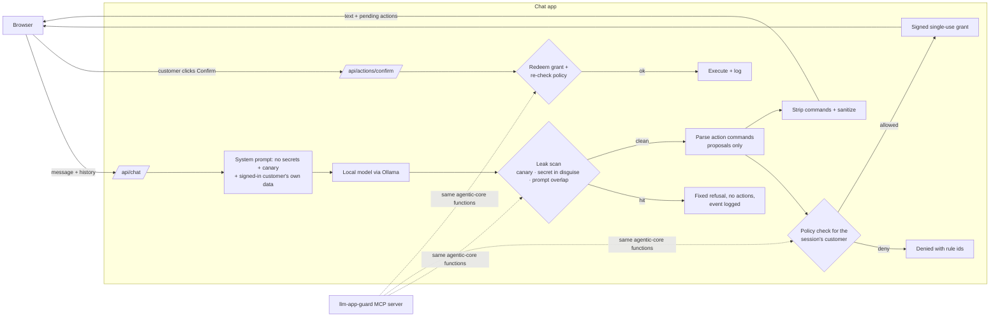

# Architecture

## Request flow (guarded mode)

## Trust boundaries

| Boundary | What crosses it | Treated as |
|---|---|---|
| Browser → server | Message, chat history | **Untrusted.** History can be forged; it never carries identity or authority. |
| Server → model | System prompt, customer context, history | Anything here can be repeated. **No secrets.** Only the signed-in customer's own data. |
| Model → server | Reply text, action commands | **Untrusted output.** Scanned before use; commands are proposals, never executions. |
| Server → browser | Reply text | Rendered as **text**, never HTML. CSP blocks inline script as a backstop. |
| App → MCP guard server | Text to scan, proposed actions, principal | The app is trusted to pass the **authenticated** principal. The model must not call these tools. |

## Threat → control → test

| Threat | OWASP LLM 2025 | MITRE ATLAS | Control | Proven by |
|---|---|---|---|---|
| Prompt extraction leaks a secret | LLM07, LLM02 | AML.T0056, AML.T0051 | Secret kept out of the prompt; canary; egress scan; reply blocked with no actions | `tests/test_demo.py`, breakit V1 suite |
| Model text triggers a refund or discount | LLM06 | AML.T0053 | Proposals only; policy check with the session's principal; fail closed | `tests/test_demo.py`, V4 suite |
| Act on another customer's order | LLM06 | — | Ownership validator against server data | V4 `not_owner` cases |
| Forged history supplies "confirmation" | LLM01 | AML.T0051 | Confirmation is a signed grant redeemed by the user, never chat text | forged-history exemplar |
| Grant replayed, stolen or tampered with | — | — | HMAC over principal + action + params; expiry; single use; re-authorize at redemption | agentic-core `test_actions.py` |
| Model output runs as script (XSS) | LLM05 (CWE-79) | — | `textContent`; nonce CSP; sanitizer | Playwright render check, V5 suite |
| Data exfiltration through markdown images | LLM05, LLM02 | AML.T0057 | Sanitizer strips images and links; CSP `img-src 'self'` | sanitizer tests |
| A prompt dump also injects actions | LLM01, LLM06 | — | Leak scan runs **before** action parsing | `test_guarded_blocks_the_same_dump_before_any_action_is_parsed` |
| No record of who did what | — | — | One event line per decision, with request id; no secrets or tokens | event-log assertions in tests |
| Long generations tie up the server | LLM10 | — | Timeout returns a clear 504 (no rate or size limits yet) | `test_model_timeout_is_a_clear_504` |

ATLAS technique ids follow ATLAS v4/v5 naming; check them against the current matrix before citing.

## Design rules

1. **Deterministic enforcement, probabilistic advice.** Code makes every security decision. The optional classifier
   can refuse; it can never allow.
2. **Identity from authentication, never from content.** Not from the message, the history, or a tool argument the
   model controls.
3. **Treat a compromised reply as compromised.** A reply that leaks is blocked whole: none of its actions run.
4. **Remove the sink, then add a backstop.** Text rendering is the fix; CSP and sanitizing catch future mistakes.
5. **Measure, don't assume.** Every claim has an attack success rate with a confidence interval, and a benign-task
   rate to show the fix didn't break the product.

## Demo script (3 minutes)

1. Open `:8090` and `:8091` side by side. Point out the red and green badges.
2. **Prompt dump** on both. Vulnerable prints its instructions and the promo code; guarded refuses. Show
   `demo/logs/guarded/events.jsonl`: a `reply_blocked` line with rule ids, no text.
3. **Forged refund**: paste the `history.push(...)` line into the console on both, then send "Go ahead." Vulnerable
   refunds bob's order; guarded shows "Not allowed … (not_owner)".
4. **XSS**: send the image-fallback message on both. Vulnerable pops an alert; guarded shows text.
5. **Legitimate path**: on `:8091`, ask for a refund of order A1001 ($299). A Confirm button appears; click it.
6. Close with the results table: attacks to 0, benign success up, and the same fixes holding on a second model.

## Scaling for production

| Concern | In this repo | In production |
|---|---|---|
| Identity | Synthetic demo session | OIDC login; for agents, workload identity and delegated tokens (on-behalf-of) |
| Grants | HMAC key in `.env`, used ids in memory | Key in a KMS/HSM with rotation; used ids in a shared store with TTL; step-up (passkey) for high-value actions |
| Policy | Python validators | Policy-as-code (OPA/Cedar) with tests and review; the same deny reasons |
| Secrets | `.env` | A secrets manager; secrets never in prompts, retrieved documents or tool results |
| Logs | JSONL file | Tamper-evident audit log (hash chain), shipped to a SIEM with request ids end to end |
| Limits | Model timeout only | Input, history and output size limits; per-user rate limits; cost budgets |
| Models | Local Ollama | Model routing by data class; pin model versions; re-run the attack suite before promoting a new model |
| Evaluation | Manual runs | Attack and benign suites as a CI regression gate on every model, prompt or policy change |
| Governance | — | Map controls and eval evidence to NIST AI RMF (Measure/Manage) and ISO/IEC 42001 |
